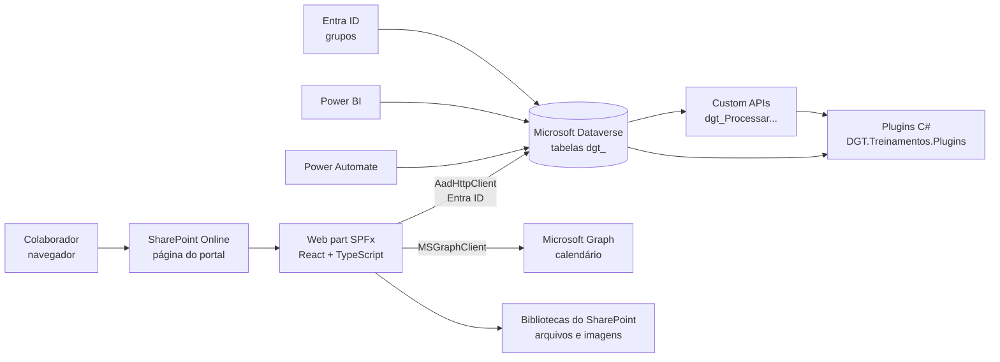
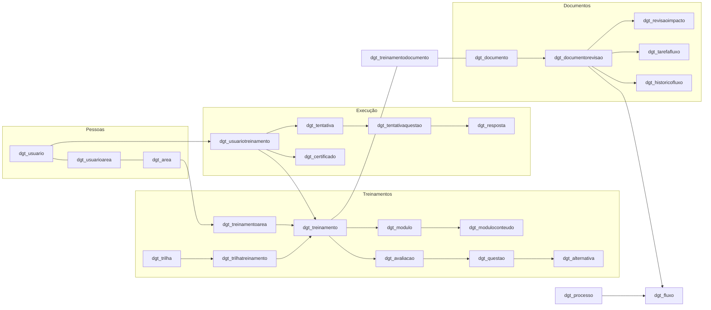

# Portal de Conhecimento e Treinamentos DGT

Plataforma corporativa de **gestão de treinamentos, conhecimento e documentos** da DGT, construída sobre o Microsoft 365 (SharePoint Online + SPFx) com dados no **Microsoft Dataverse**.

Centraliza em um só lugar: treinamentos e trilhas de aprendizagem, avaliações, certificados, validade e reciclagem, gestão documental com revisões, retreinamento por revisão de documento, acompanhamento por gestores, indicadores e auditoria completa.

Além de treinamentos e documentos, o portal reúne módulos de processos e fluxos configuráveis (BPMN), ambientes dinâmicos, RH – Pessoas, fornecedores, licitações (PNCP), Arquitetura de Soluções (B.O.M., kits e cálculo de HH), planejamento orçamentário, implantações, indicadores e IA. A função de cada tabela do Dataverse em cada módulo está na [seção 6](#6-modelo-de-dados-dataverse).

> **Regra fundamental do projeto: nunca apagar histórico.** Atribuições, tentativas, notas, certificados e revisões de documentos são preservados. Treinamentos e registros são **desativados**, não excluídos. A única exceção é a remoção de treinamentos que nunca foram atribuídos a ninguém.

---

## Sumário

1. [Funcionalidades](#1-funcionalidades)
2. [Perfis de acesso](#2-perfis-de-acesso)
3. [Arquitetura](#3-arquitetura)
4. [Tecnologias e versões](#4-tecnologias-e-versões)
5. [Estrutura do repositório](#5-estrutura-do-repositório)
6. [Modelo de dados (Dataverse)](#6-modelo-de-dados-dataverse)
7. [Plugins e Custom APIs](#7-plugins-e-custom-apis)
8. [Segurança](#8-segurança)
9. [Ambiente de desenvolvimento](#9-ambiente-de-desenvolvimento)
10. [Configuração](#10-configuração)
11. [Build, versão e publicação](#11-build-versão-e-publicação)
12. [Implantação dos plugins](#12-implantação-dos-plugins)
13. [Scripts de apoio](#13-scripts-de-apoio)
14. [Regras de negócio e convenções](#14-regras-de-negócio-e-convenções)
15. [Solução de problemas](#15-solução-de-problemas)
16. [Roadmap](#16-roadmap)
17. [Histórico de versões](#17-histórico-de-versões)
18. [Gerar Executável](#18-gerar-executável)

---

## 1. Funcionalidades

### Treinamentos (colaborador)
| Recurso | Descrição |
|---|---|
| **Visão geral** | Resumo do colaborador: concluídos, em andamento, pendentes e trilhas. |
| **Meus treinamentos** | Treinamentos atribuídos e liberados, com progresso. |
| **Execução** | Módulos com conteúdos (texto, cards, destaques, vídeo, material, link) e perguntas rápidas. |
| **Avaliação** | Banco de questões com sorteio, embaralhamento, tempo limite, tentativas e nota mínima. Correção feita no servidor. |
| **Certificados** | Emitidos após a aprovação, com validade. |
| **Trilhas** | Sequência de treinamentos com ordem e pré-requisitos. |

### Gestão de treinamentos
| Recurso | Descrição |
|---|---|
| **Criar / editar treinamento** | Fluxo guiado em 3 etapas: treinamento → módulos → avaliação. Código gerado automaticamente (`ÁREA-TRN-SEQUENCIAL`). |
| **Importar treinamento (JSON)** | Importa módulos e avaliação gerados a partir de ITs e POPs. |
| **Catálogo** | Todos os treinamentos criados, em cartões. |
| **Modo de teste** | Percorre o treinamento e a avaliação **como um colaborador**, sem gravar nada e sem gerar certificado. |
| **Atribuir treinamento** | **Por área** (todos os membros, inclusive quem entrar depois) ou **por pessoa**. |
| **Gerenciar trilhas** | Treinamentos, ordem, pré-requisitos e áreas da trilha. |
| **Histórico do treinamento** | Linha do tempo de tudo o que mudou no treinamento e na sua estrutura: quem, quando, antes e depois. |
| **Remover treinamento** | Somente Administrador, e somente treinamentos nunca atribuídos e fora de trilhas. |
| **Áreas e acessos** | Áreas, vínculo de usuários às áreas, perfil na área e perfil no portal. |

### Documentos
| Recurso | Descrição |
|---|---|
| **Visão geral** | Documentos por área, pendências, favoritos, busca e filtros. |
| **Novo documento** | Cadastro de POP, IT, política, norma, manual etc. (Editor, Gestor e Administrador). |
| **Revisões** | Elaboração → revisão → aprovação → vigência. Uma revisão nunca substitui o histórico. |
| **Retreinamento** | Ao publicar uma revisão, o sistema pergunta "Esta revisão exige retreinamento?". Se sim, gera atribuições com origem *Revisão documental*. |
| **Histórico do documento** | Todas as ações do fluxo ficam registradas. |

### Acompanhamento
| Recurso | Descrição |
|---|---|
| **Minha equipe** | Progresso, pendências e vencimentos da equipe (Gestor). |
| **Conformidade** | Concluídos, pendentes e vencidos por área e por treinamento. |
| **Indicadores** | Área para os relatórios do Power BI. |

### Plataforma
- **Versão do portal** visível no cabeçalho (selo `vX.Y.Z`), com a tela **Novidades**.
- **Diagnóstico de acesso**, que explica os erros de conexão com o Dataverse.

---

## 2. Perfis de acesso

O portal usa **dois níveis de perfil**, independentes entre si:

| Nível | Onde fica | Para que serve |
|---|---|---|
| **Perfil no portal** | `dgt_usuario.dgt_perfilacesso` | Define as telas liberadas no portal inteiro. |
| **Perfil na área** | `dgt_usuarioarea.dgt_perfilarea` | Vale só naquela área. Exemplo: o Gestor **da área** aprova os documentos dela. |

### Perfil no portal

| Perfil | Pode |
|---|---|
| **Funcionário** | Fazer os próprios treinamentos e avaliações, e consultar documentos e certificados. |
| **Editor** | Tudo do Funcionário, e ainda criar e editar treinamentos, módulos, avaliações, trilhas, documentos e revisões (enviando para aprovação). **Não** aprova, **não** atribui, **não** vê equipe nem indicadores e **não** administra acessos. |
| **Gestor** | Tudo do Funcionário, e ainda equipe, atribuições, conformidade, indicadores e criação de documentos. Aprova documentos das áreas em que é **Gestor da área**. |
| **Administrador** | Tudo, incluindo Áreas e acessos, remoção de treinamentos e aprovação em qualquer área. |

### Rotas por perfil

| Rota | Funcionário | Editor | Gestor | Administrador |
|---|:-:|:-:|:-:|:-:|
| Início, Treinamentos, Trilhas, Documentos, Certificados, Avaliação | ✅ | ✅ | ✅ | ✅ |
| Novo documento | | ✅ | ✅ | ✅ |
| Gestão, Criar treinamento, Trilhas, Módulos, Avaliações, Gestão de documentos | | ✅ | | ✅ |
| Catálogo e Modo de teste | | ✅ | | ✅ |
| Minha equipe, Atribuir, Conformidade, Indicadores | | | ✅ | ✅ |
| Áreas e acessos, Remover treinamento | | | | ✅ |

As regras ficam em `services/RoutePermissionService.ts` (rotas) e `services/MenuPermissionService.ts` (abas).

> ⚠️ A tela **organiza** o acesso. A **proteção real dos dados** é feita pelas **funções de segurança do Dataverse** (seção 8). Sempre que mudar o perfil de alguém, ajuste **os dois**: o perfil no portal (em Áreas e acessos) e a função de segurança (no Dataverse).

---

## 3. Arquitetura



- **Frontend:** um único web part SPFx (`PortalTreinamentosWebPart`), com roteamento interno (`PortalRouter.tsx`). A aparência é de aplicação corporativa, sem o visual padrão do SharePoint.
- **Dados:** as informações estruturadas ficam no Dataverse. Os arquivos (documentos, PDFs e imagens de capa) ficam no SharePoint.
- **Regras críticas no servidor:** atribuição, correção de avaliação, reciclagem, revisão documental, geração de código, auditoria e atribuição por área rodam em **plugins** C#, e não só no navegador.
- **Identidade:** Microsoft Entra ID. O usuário do portal precisa existir no Dataverse (`systemuser`) e em `dgt_usuario`.

Fluxo principal:

```
Área / Grupo / Função → Usuário → Trilha → Treinamentos → Módulos → Avaliação
  → Conclusão → Certificado → Validade → Reciclagem / Retreinamento
```

---

## 4. Tecnologias e versões

| Camada | Tecnologia | Versão |
|---|---|---|
| Framework | SharePoint Framework (SPFx) | 1.22.2 |
| Build | Heft (`@rushstack/heft`) | ^1.2.7 |
| UI | React / React DOM | 17.0.1 |
| Linguagem | TypeScript | ~5.8.3 |
| Componentes | Fluent UI React | ^8.106 |
| Node.js | Node | **>= 22.14 e < 23** |
| Dados | Microsoft Dataverse (Web API v9.2) | — |
| Plugins | .NET Framework / C# | net462 · `Microsoft.CrmSdk.CoreAssemblies` 9.0.2.59 |
| Automação | Power Automate | — |
| Relatórios | Power BI | — |

> O SPFx deste projeto compila com a biblioteca **ES2015**. Funções mais novas, como `padStart`, não estão disponíveis. Antes de usar um recurso recente de JavaScript, confira se ele existe no ES2015; na dúvida, prefira `indexOf`, `Object.keys` e laços simples.

---

## 5. Estrutura do repositório

Visão das pastas principais. Arquivos de teste (`*.test.ts`, `*.test.tsx`) ficam ao lado do código que testam e rodam no `npm run build` (`heft test`).

```
DGT-Portal-Treinamentos/
├── CHANGELOG.md                      Histórico de versões (fonte da tela "Novidades")
├── Gerar-Versao.ps1                  Gera uma versão: incrementa, compila e empacota (seção 11)
├── README.md
├── package.json                      Scripts npm (build, start, versao, clean)
├── tsconfig.json  .eslintrc.js  .nvmrc   Configuração de TypeScript, lint e versão do Node (22)
├── config/
│   ├── package-solution.json         Versão do pacote SharePoint e permissões de API
│   └── ...                           Configuração do SPFx/Heft (serve, sass, write-manifests...)
├── docs/                             Guias de implantação e configuração por módulo
│   ├── alinhamento-tabelas.md        Plano de alinhamento e remoção de tabelas duplicadas
│   ├── ambientes.md                  Ambientes dinâmicos
│   ├── fluxo-dataverse.md            Fluxo de revisão por processo (tabelas e permissões)
│   ├── subprocessos.md               Subprocessos nos fluxos
│   ├── pacote-processo.md            Formato do pacote JSON de processo/fluxo
│   ├── assinatura-digital.md         Assinatura digital (Power Automate + Clicksign)
│   ├── fornecedores.md               Fornecedores e homologação
│   ├── implantacoes.md               Painel de Implantações
│   ├── integracao-cigam-precos.md    Preços do CIGAM nos kits
│   ├── indicadores-clickup.md        Indicadores e integração com o ClickUp
│   ├── ia-*.md                       IA: administração, licitações e dashboards
│   ├── componentes.md  scripts.md    Componentes de fluxo e scripts das etapas
│   ├── dashboards/exemplos/          Modelos de dashboard (JSON)
│   ├── exemplos/                     Pacotes de processo de exemplo (JSON)
│   └── skill-criador-processos-dgt/  Skill para criar pacotes de processo com IA
├── scripts/
│   ├── versao.js                     Controle de versão (chamado pelo Gerar-Versao.ps1 e pelo npm)
│   ├── gerar-estilos-bpmn.js         Gera os estilos do editor BPMN
│   └── dataverse/                    Scripts PowerShell de criação de tabelas, colunas e APIs
│                                     (criar-tabelas-*.ps1, criar-coluna-*.ps1), diagnóstico,
│                                     limpeza e listar-tabelas-dataverse.ps1 (inventário)
├── server/
│   ├── DGT.Treinamentos.Plugins/     Plugins e Custom APIs do Dataverse (C#, net462, assinado com .snk)
│   │   ├── Processar*Plugin.cs       Atribuição, avaliação, reciclagem e revisão documental
│   │   ├── Atribuir*Plugin.cs        Atribuição automática por área e por trilha
│   │   ├── *Licitacao*, *ClickUp*    Acompanhamento do PNCP, análise por IA e tarefas do ClickUp
│   │   ├── ConsultarFornecedorPlugin.cs, DocumentosRecebidosFornecedor.cs
│   │   ├── *DashboardIa*, GerenciarIaPlugin.cs, IaComum.cs   IA dos dashboards e administração
│   │   └── Recursos/                 Instruções embarcadas (ex.: criação de dashboards por IA)
│   └── DGT.Treinamentos.Plugins.Tests/   Testes dos plugins (prazos de licitação, documentos recebidos)
├── sharepoint/solution/              (gerado) pacote .sppkg
├── teams/                            Ícones para uso no Teams
└── src/webparts/portalTreinamentosWebPart/
    ├── PortalTreinamentosWebPart.ts       Entrada do web part (URL do Dataverse)
    ├── assets/                            Logotipo e imagens de boas-vindas
    ├── components/
    │   ├── PortalTreinamentos.tsx         Layout, estado global e ações
    │   ├── PortalRouter.tsx               Roteamento das páginas
    │   ├── layout/                        Sidebar, Topbar, cabeçalhos de página e de módulo
    │   ├── common/                        Componentes reutilizáveis (ícones, avisos, diagnóstico, estados de carga e erro...)
    │   ├── fluxo/                         Motor visual dos fluxos: diagrama, campos das etapas, painel de assinatura
    │   │   ├── bpmn/                      Editor BPMN (modelador e estilos)
    │   │   └── componentes/               Componentes embutidos nas etapas (Cálculo de HH, Montador de B.O.M., HTML)
    │   └── treinamento/  treinamentos/    Cartões e indicadores de progresso dos treinamentos
    ├── constants/
    │   ├── routes.ts                      Lista de páginas (rotas)
    │   ├── moduleRoutes.ts                Módulo a que cada página pertence
    │   ├── dataverseChoices.ts            Valores das colunas de escolha
    │   ├── controleDocumental.ts  tiposDocumento.ts   Regras e tipos de documento
    │   ├── ia.ts  crm.ts  featureFlags.ts  designTokens.ts   IA, CRM, recursos liberados e identidade visual
    │   └── versao.ts                      (gerado) versão e novidades
    ├── hooks/                             Estado e carregamento por tela (useGestao..., useDocumento..., useLicitacoes...)
    ├── models/                            Tipos de domínio (Treinamento, Módulo, Avaliação, Documento, Fluxo, Ambiente, Licitação...)
    ├── pages/                             Uma pasta por módulo (rotas na seção 6.1)
    │   ├── Inicio/  Intranet/             Tela inicial
    │   ├── Treinamentos/                  Visão geral, meus treinamentos, execução, catálogo, modo de teste
    │   ├── Avaliacao/                     Avaliação e revisão das respostas
    │   ├── Trilhas/  Certificados/  Historico/  Suporte/
    │   ├── Gestao/                        Gestão de treinamentos, módulos, avaliações, trilhas, atribuição,
    │   │                                  áreas, conformidade, equipe, mídias e revisões de treinamento
    │   ├── Documentos/                    Home, detalhe, novo documento, fluxo de revisão, pendências
    │   ├── Processos/                     Fluxos (editor BPMN, metadados, subprocessos, pacotes) e processos de negócio
    │   ├── Ambientes/                     Ambientes dinâmicos e seus registros
    │   ├── Conta/                         Meu perfil, preferências de avisos e Usuários e acessos
    │   ├── RH/                            RH – Pessoas: certificações, fabricantes, terceiros, pendências de acesso
    │   ├── Fornecedores/                  Cadastro, ficha, homologação (kanban), documentos e colaboradores
    │   ├── Licitacoes/                    Busca no PNCP, parecer, acompanhamento e análise por IA
    │   ├── Arquitetura/                   Demandas, Matriz Go/No-Go, B.O.M., seletor de servidor e ROs
    │   ├── Kits/                          Catálogo de itens, kits, composição, servidores e histórico
    │   ├── HH/                            Cálculo de HH (premissas, custos, equipe, versões)
    │   ├── Orcamento/                     Planejamento orçamentário (planilhas, aprovações, plano de contas, regras)
    │   ├── Implantacoes/                  Painel de Implantações (inclui o aplicativo legado em legado/)
    │   ├── Indicadores/                   Dashboards, editor visual, criação com IA e Administrar IA
    │   └── CRM/                           Integração com o CRM
    ├── services/                          Acesso ao Dataverse e regras do portal
    │   ├── DataverseService.ts            Cliente da Web API (ponto único de acesso ao Dataverse)
    │   ├── AutorizacaoService.ts          Perfil do usuário logado, módulos liberados e permissões
    │   ├── RoutePermissionService.ts      Permissão por rota
    │   ├── MenuPermissionService.ts       Abas visíveis por perfil
    │   ├── *Service.ts  *AdminService.ts  Serviços de treinamentos, documentos, trilhas, atribuições e certificados
    │   ├── fluxo/                         Motor dos fluxos (FluxoEngine), validação, responsáveis, subprocessos
    │   ├── processos/                     Fluxos (dgt_processo), metadados, processos de negócio, transferência e remoção
    │   ├── ambientes/                     Ambientes dinâmicos: registros, anexos, layout, subprocessos
    │   ├── pacoteProcesso/                Importação e exportação de pacotes JSON de processo
    │   ├── assinatura/                    Pedidos de assinatura digital
    │   ├── cadastros/                     Vínculo por nome com os cadastros de fabricante e área (alinhamento das tabelas)
    │   ├── referencias/  controle/        Referências entre documentos e documento de controle do treinamento
    │   ├── fornecedores/                  Fornecedores, homologação e documentos
    │   ├── licitacoes/                    Acompanhamento de editais, pasta no SharePoint, tarefas do ClickUp
    │   ├── bom/                           B.O.M., Go/No-Go, kits, catálogo de servidores e preços do CIGAM
    │   ├── hh/  orcamento/  implantacoes/ Cálculo de HH, orçamento e painel de Implantações
    │   ├── dashboards/                    Fontes de dados, modelos e criação de dashboards com IA
    │   ├── ia/                            Administração, prompts e chamadas de IA (via Custom APIs)
    │   ├── crm/                           Conexão com o CRM
    │   ├── notificacoes/                  Avisos do portal e preferências
    │   ├── microsoft365/                  Calendário (Microsoft Graph)
    │   └── sharepoint/                    Arquivos de documentos no SharePoint
    └── utils/                             Formatação, fuso horário, regras de acesso, diagnóstico, imagens e arquivos
                                           do SharePoint, numeração de revisão, vencimentos, exportação para Excel
```

> **Arquivos avulsos na raiz:** o repositório também tem arquivos de trabalho (`*.patch`, `*.diff`, `doc.md`) e cópias de segurança (`*.bak`, `*.bak-AAAAMMDD-*`, `*.antes-*`) em `src/`. Eles não fazem parte do build. A recomendação é removê-los do Git ou movê-los para uma pasta `ferramentas/` ou `arquivo/`.

---

## 6. Modelo de dados (Dataverse)

Ambiente: **DGT – Automação Processos** · Solução: **DGT – Portal de Conhecimento e Treinamentos** · Prefixo: `dgt_` (as tabelas da Arquitetura de Soluções usam `dgt_bom_`).

O portal tem **101 tabelas** personalizadas. Elas estão organizadas abaixo **pelo módulo do portal que as usa**, com a função de cada uma e onde ela aparece (tela, serviço, plugin ou automação). Para a lista completa de colunas, use o script `scripts/dataverse/listar-tabelas-dataverse.ps1`, que gera os arquivos `Dataverse_Tabelas.csv` e `Dataverse_Tabelas_Colunas.csv`.

### 6.1 Mapa dos módulos

| Módulo | Rota(s) no portal | Tabelas | Processamento no servidor |
|---|---|---|---|
| [Pessoas, áreas e acessos](#63-pessoas-áreas-e-acessos-base-compartilhada) | `usuariosAcessos`, `gestaoAreas`, `meuPerfil` | 6 | `AtribuirPorAreaPlugin`, `AtribuirTrilhaPorAreaPlugin` |
| [Treinamentos: conteúdo](#64-treinamentos--conteúdo) | `gestao`, `novoTreinamento`, `gestaoModulos`, `gestaoAvaliacoes`, `catalogoTreinamentos` | 10 | `GerarCodigoTreinamentoPlugin`, `AuditarTreinamentoPlugin` |
| [Treinamentos: trilhas e regras de atribuição](#65-treinamentos--trilhas-e-regras-de-atribuição) | `trilhas`, `gestaoTrilhas`, `atribuirTreinamento` | 7 | `AtribuirPorAreaPlugin`, `AtribuirTrilhaPorAreaPlugin`, `dgt_ProcessarAtribuicao` |
| [Treinamentos: execução e evidências](#66-treinamentos--execução-e-evidências) | `treinamentos`, `executarModulo`, `avaliacao`, `certificados`, `equipe`, `gestaoConformidade` | 8 | `dgt_ProcessarAvaliacao`, `dgt_ProcessarReciclagem`, `ObterDadosCertificadoPlugin` |
| [Documentos](#67-documentos-e-controle-documental) | `documentos`, `documentoDetalhe`, `novoDocumento`, `gestaoDocumentos` | 7 | `dgt_ProcessarRevisaoDocumento`, Power Automate (Clicksign) |
| [Processos e fluxos (BPMN)](#68-processos-e-fluxos-configuráveis) | `processos`, `fluxos` | 7 | — |
| [Ambientes dinâmicos](#69-ambientes-dinâmicos) | `ambiente` | 2 | `ValidarAcaoAdministrativaRegistroPlugin` |
| [RH – Pessoas](#610-rh--pessoas-e-certificações) | `rhPessoas` | 5 | — |
| [Fornecedores](#611-fornecedores-suprimentos) | `fornecedores` | 8 | `dgt_ConsultarFornecedor`, recebimento de documentos por e-mail |
| [Licitações (PNCP)](#612-licitações-pncp) | `licitacoes` | 4 | `AcompanhamentoLicitacaoPlugin`, `dgt_AnalisarLicitacaoIa`, `BaixarArquivoPncpPlugin`, ClickUp |
| [Arquitetura de Soluções (B.O.M.)](#613-arquitetura-de-soluções--bom) | `arquitetura`, `arquiteturaROs` | 8 | — |
| [Kits, servidores e preços](#614-kits-servidores-e-preços-cigam) | `kits` | 7 | Power Automate (CIGAM) |
| [Cálculo de HH](#615-cálculo-de-hh) | `calculoHH` | 2 | — |
| [Planejamento orçamentário](#616-planejamento-orçamentário) | `planejamentoOrcamentario` | 7 | — |
| [Implantações e projetos (PMO)](#617-implantações-e-projetos-pmo) | `implantacoes` | 7 | Power Automate (e-mails) |
| [Indicadores e IA](#618-indicadores-e-ia) | `indicadores` e telas com IA | 4 | `dgt_GerenciarIa`, `dgt_PerguntarDashboardIa`, `dgt_GerarDashboardIa` |
| [Auditoria e monitoramento](#619-auditoria-e-monitoramento) | Históricos das telas | 2 | `AuditarTreinamentoPlugin`, automações |

### 6.2 Convenções do modelo

- **Histórico não se apaga.** Tabelas de histórico (`*historico`, `*alteracao`, `*evento`, `*log`, `dgt_auditorianegocio`, `dgt_historicofluxo`) só recebem novas linhas. Registros de negócio são desativados por `dgt_ativo`/`dgt_ativa` (ou `dgt_excluido` no painel de Implantações).
- **Versões em vez de sobrescrita.** Revisões de documento, revisões de treinamento, versões de fluxo, cálculos de HH, prompts de IA, documentos de fornecedor e análises Go/No-Go criam um registro novo a cada mudança. A versão anterior fica marcada como Substituída/Arquivada.
- **Retrato no momento do evento.** Tentativas guardam o enunciado e o peso da questão (`dgt_tentativaquestao`), notas Go/No-Go guardam o nome e o peso do critério (`dgt_bom_analisenota`). Editar o cadastro depois não altera o histórico.
- **Colunas JSON.** Estruturas flexíveis ficam em colunas de texto JSON (ex.: `dgt_definicaojson`, `dgt_estadofluxojson`, `dgt_valoresjson`, `dgt_dados`). O portal é o responsável por validá-las.
- **Propriedade.** A maioria das tabelas é *UserOwned*. São *OrganizationOwned* (sem proprietário por registro): `dgt_treinamento`, `dgt_modulo`, `dgt_erroautomacao`, `dgt_cigamsincronizacao`, `dgt_hhcalculo`, `dgt_hhalteracao`, `dgt_iaconfiguracao`, `dgt_iaconsumo`, as tabelas `dgt_kit*`, `dgt_servidor*` e `dgt_bom_rovalidade`.
- **Colunas protegidas (segurança de coluna).** Ver seção 8, [Dados pessoais (LGPD)](#dados-pessoais-lgpd).

### 6.3 Pessoas, áreas e acessos (base compartilhada)

Usadas por **todos** os módulos para identificar o usuário, definir o que ele vê e filtrar dados por área.

| Tabela | Função | Aplicação no portal |
|---|---|---|
| `dgt_usuario` | Colaborador sincronizado do Entra ID: nome, e-mail, UPN, Entra Object ID, matrícula, cargo, **perfil no portal** (`dgt_perfilacesso`) e **módulos liberados** (`dgt_modulosacesso`). | Login e autorização (`AutorizacaoService`), Usuários e acessos, Meu perfil. É referenciada por atribuições, certificados, auditoria e consumo de IA. |
| `dgt_area` | Áreas da empresa (nome, sigla, ativa). | A sigla compõe o código do treinamento. Filtra documentos, processos, orçamento, dashboards, IA e demandas do B.O.M. |
| `dgt_usuarioarea` | Vínculo usuário ↔ área com **perfil na área** (Membro, Editor, Gestor, Administrador da área), cargo e área principal. | Áreas e acessos. Define quem aprova documentos da área, dispara a atribuição automática por área (plugins) e limita o escopo de dashboards e da IA. |
| `dgt_setor` | Setores organizacionais. | Referenciada por `dgt_revisaoimpacto` e `dgt_documentosetor`, mas sem tela que a leia ou grave. O painel de Implantações tem um cadastro próprio de setores, guardado em `dgt_implregistro`. |
| `dgt_funcao` | Funções (cargos) corporativas, com código externo. | Público de trilhas (`dgt_usuariotrilha`) e de impacto de revisões. |
| `dgt_grupo` | Grupos do Microsoft 365/Entra ID (Object ID e e-mail). | Público de trilhas e de impacto de revisões. Também usado em fontes de dashboard e no orçamento. |

### 6.4 Treinamentos – conteúdo

O que o Editor monta no fluxo guiado **treinamento → módulos → avaliação**.

| Tabela | Função | Aplicação no portal |
|---|---|---|
| `dgt_treinamento` | **Cadastro mestre**: código `ÁREA-TRN-SEQUENCIAL`, sequencial, área, tipo, carga horária, nota mínima, validade em meses, imagem de capa e documento de controle. | Catálogo, Criar/editar treinamento, Meus treinamentos. Código gerado por `GerarCodigoTreinamentoPlugin`; mudanças auditadas por `AuditarTreinamentoPlugin`. |
| `dgt_modulo` | Módulos do treinamento: título (`dgt_titulo`), ordem, obrigatório, duração e tipo. | Gestão de módulos e Execução do treinamento. |
| `dgt_moduloconteudo` | Blocos de conteúdo do módulo: texto, cards (`__DGT_CARDS__:[...]`), destaque, vídeo, material e link. | Editor de conteúdos do módulo, importação de treinamento (JSON) e tela de execução. |
| `dgt_modulopergunta` | Pergunta rápida ligada a um bloco de conteúdo: enunciado, tipo, exigir acerto, feedbacks. | Editor de perguntas rápidas; aparece durante a execução do módulo. |
| `dgt_moduloperguntaalternativa` | Alternativas da pergunta rápida, com a correta. | Editor de perguntas rápidas e execução do módulo. |
| `dgt_avaliacao` | Configuração da avaliação final: quantidade de questões, nota mínima, tentativas, tempo limite, sorteio, embaralhamento e exibição do resultado. | Gestão de avaliações e tela de Avaliação. Lida por `dgt_ProcessarAvaliacao`. |
| `dgt_questao` | Banco de questões: enunciado, tipo, peso, múltiplas respostas e explicação. | Gestão de avaliações; o sorteio é feito a partir dela. |
| `dgt_alternativa` | Alternativas das questões, com **gabarito** e justificativa. | Gestão de avaliações. O gabarito é usado na correção no servidor (`dgt_ProcessarAvaliacao`). |
| `dgt_midia` | Imagem enviada pelo portal para os conteúdos. O arquivo fica na biblioteca *Midias de Treinamento* e nunca é sobrescrito. | Mídias do treinamento e seletor de imagem do editor. |
| `dgt_treinamentorevisao` | Revisão (versão) do treinamento: número, motivo, alterações, **requer retreinamento**, prazo, usuários impactados e atribuições criadas. | Publicar revisão do treinamento. Gera reatribuições por `dgt_ProcessarAtribuicao`. |

### 6.5 Treinamentos – trilhas e regras de atribuição

Definem **quem** deve fazer **o quê**. As atribuições geradas ficam em `dgt_usuariotreinamento` e `dgt_usuariotrilha` (6.6).

| Tabela | Função | Aplicação no portal |
|---|---|---|
| `dgt_trilha` | Trilha de capacitação: código, descrição e "todas as áreas". | Trilhas (colaborador) e Gerenciar trilhas. |
| `dgt_trilhatreinamento` | Treinamentos da trilha: ordem, obrigatório, prazo em dias e regra de liberação. | Gerenciar trilhas. Controla a sequência liberada por `dgt_ProcessarAtribuicao` e `dgt_ProcessarAvaliacao`. |
| `dgt_trilhatreinamentoprerequisito` | Pré-requisitos de um item da trilha (o que precisa ser concluído antes). | Gerenciar trilhas. |
| `dgt_trilhaarea` | Áreas que recebem a trilha. | Gerenciar trilhas. Dispara `AtribuirTrilhaPorAreaPlugin`. |
| `dgt_treinamentoarea` | **Regra de atribuição por área**: treinamento → área, prazo e usuários excluídos. Vale também para quem entrar na área depois. | Atribuir treinamento → Por área. Dispara `AtribuirPorAreaPlugin`. |
| `dgt_grupotrilha` | Público da trilha por grupo do Microsoft 365, com prazo e obrigatoriedade. | Prevista para a atribuição automática por grupo (Power Automate). Sem uso no código atual do portal. |
| `dgt_funcaotrilha` | Público da trilha por função, com prazo e obrigatoriedade. | Prevista para a atribuição automática por função. Sem uso no código atual do portal. |

### 6.6 Treinamentos – execução e evidências

O **histórico do colaborador**. Nenhuma função de segurança tem Excluir em `dgt_usuariotreinamento`, `dgt_tentativa` e `dgt_certificado`.

| Tabela | Função | Aplicação no portal |
|---|---|---|
| `dgt_usuariotreinamento` | **Atribuição**: status, origem (Individual, Grupo, Função, Reciclagem, Revisão documental, Mudança de função), datas de atribuição, liberação, início, limite, conclusão e validade, nota, revisão treinada e trilha. | Visão geral, Meus treinamentos, Minha equipe, Conformidade e Indicadores. Gravada pelos plugins de atribuição, avaliação, reciclagem e revisão documental. |
| `dgt_usuariotrilha` | Atribuição de trilha ao usuário: origem (grupo, função, área), prazo, obrigatoriedade e status. | Trilhas do colaborador e acompanhamento do gestor. |
| `dgt_usuariomodulo` | Progresso por módulo: início, conclusão e tempo utilizado. | Barra de progresso e execução do treinamento. |
| `dgt_moduloperguntaresposta` | Respostas às perguntas rápidas, com acerto e tentativa. | Execução do módulo (libera o avanço quando exige acerto). |
| `dgt_tentativa` | Cada tentativa de avaliação: número, início, término, tempo, acertos, erros, nota e aprovação. | Avaliação e Revisão das respostas. Criada e corrigida por `dgt_ProcessarAvaliacao`. |
| `dgt_tentativaquestao` | Questões efetivamente apresentadas na tentativa, com **retrato** do enunciado, peso aplicado e pontos obtidos. | Revisão das respostas e auditoria da prova. |
| `dgt_resposta` | Alternativas apresentadas e selecionadas em cada questão, com a ordem e o gabarito esperado. | Revisão das respostas. |
| `dgt_certificado` | Certificado emitido após a aprovação: número, emissão, validade e arquivo no SharePoint. | Certificados (colaborador) e RH – Pessoas. Dados montados por `ObterDadosCertificadoPlugin`. |

### 6.7 Documentos e controle documental

| Tabela | Função | Aplicação no portal |
|---|---|---|
| `dgt_documento` | **Identidade permanente** do documento: código, título, tipo (POP, IT, MAP, política...), área, processo de negócio, responsável, revisão atual e status. | Documentos (home, detalhe, novo) e Gestão de documentos. |
| `dgt_documentorevisao` | **Cada revisão**: arquivo e conteúdo, motivo, alterações, **requer retreinamento**, fluxo seguido e seu estado (etapa atual, situação), aprovação e vigência. | Aba Fluxo de revisão, Minhas pendências e Histórico do documento. Publicada por `dgt_ProcessarRevisaoDocumento`. |
| `dgt_treinamentodocumento` | Vínculo treinamento ↔ documento (obrigatório, ordem). | Aba Referências do documento e Gestão de treinamentos. **É a base do retreinamento**: define quem é impactado quando o documento é revisado. |
| `dgt_revisaoimpacto` | Público impactado pela revisão (usuário, setor, função, grupo, processo ou trilha), tipo de impacto e prazo. | Calculada na publicação da revisão a partir dos treinamentos vinculados. Mostrada no resultado da publicação. |
| `dgt_documentoprocesso` | Vínculo documento ↔ fluxo (`dgt_processo`), com o principal. | Define o fluxo que as revisões do documento seguem. |
| `dgt_documentosetor` | Vínculo documento ↔ setor. | Classificação. Sem tela no portal hoje; usada apenas pelos scripts de limpeza. |
| `dgt_assinatura` | Pedido de assinatura digital de um documento ou registro: arquivos, signatários, ordem, prazo, situação e arquivo assinado. | Etapa "Assinatura digital" dos fluxos (documentos e ambientes). Enviada e acompanhada pelo Power Automate (Clicksign). Ver `docs/assinatura-digital.md`. |

### 6.8 Processos e fluxos configuráveis

Fluxos de aprovação desenhados em BPMN na tela **Processos → Fluxos**, seguidos pelas revisões de documento e pelos registros de ambiente. Ver `docs/fluxo-dataverse.md` e `docs/subprocessos.md`.

> Atenção aos nomes: `dgt_processo` é o **fluxo** (o cartão em Processos → Fluxos). O processo de negócio da área, que agrupa documentos, é `dgt_processonegocio`. As duas tabelas têm o nome de exibição "Processo".

| Tabela | Função | Aplicação no portal |
|---|---|---|
| `dgt_processo` | O **fluxo** (cartão): código, área e descrição. Também classifica documentos e entra na análise de impacto. | Processos → Fluxos. Ao remover, o fluxo é arquivado se já houver revisões que passaram por ele. |
| `dgt_fluxo` | **Versão** do fluxo: desenho BPMN (`dgt_bpmnxml`), configuração das etapas (`dgt_definicaojson`), situação (rascunho, publicada, arquivada). | Editor de fluxo. A versão publicada é a que os registros seguem. |
| `dgt_processometadado` | Campos do fluxo usados nas etapas (tipo, opções, colunas de tabela, ajuda). A ordem define a ordem nas telas. | Formulários das etapas em documentos e ambientes. |
| `dgt_tarefafluxo` | **Pendência**: etapa aguardando os responsáveis, com prazo e situação. | Minhas pendências, avisos e dashboards. |
| `dgt_historicofluxo` | Cada ação executada no fluxo: etapa, ação, resultado, comentário, quem e quando. | Histórico (tramitação) da revisão. |
| `dgt_processonegocio` | Processo de negócio da área: agrupa documentos (POP, MAP, IT...) e define o **fluxo padrão**. | Cadastro de processos; escolha do fluxo ao criar documentos. |
| `dgt_processonegociofluxo` | Exceção: fluxo próprio para um tipo de documento dentro do processo de negócio. | Cadastro de processos. |

### 6.9 Ambientes dinâmicos

Permitem criar módulos novos (ex.: Licitações, Compras, Jurídico) **sem código novo**. Ver `docs/ambientes.md`.

| Tabela | Função | Aplicação no portal |
|---|---|---|
| `dgt_ambiente` | Cadastro do ambiente: nome, chave, ícone, ordem, prefixo do código, layout, perfis padrão, biblioteca de anexos e fluxo (`dgt_processo`). | Menu lateral e "+ Adicionar ambiente". Liberado em Usuários e acessos como os demais módulos. |
| `dgt_ambienteregistro` | Cada registro do ambiente (solicitação, processo licitatório...): código, área, solicitante, situação, etapa atual, prazo, responsáveis, valores dos campos e estado do fluxo. | Visão geral e tela do registro. Ações administrativas validadas por `ValidarAcaoAdministrativaRegistroPlugin`. |

### 6.10 RH – Pessoas e certificações

| Tabela | Função | Aplicação no portal |
|---|---|---|
| `dgt_certificadoexterno` | Certificado obtido fora da plataforma (ensino superior, cursos, NRs, certificações), com validade e arquivo no SharePoint. | RH – Pessoas: cadastro pelo RH e visão consolidada com os certificados internos. |
| `dgt_certificacaofabricante` | Certificação de fabricante ou registro profissional (CREA/CFT) de um colaborador (`dgt_usuario`) ou terceiro, com criticidade e vencimento. Fabricante e área em texto, com os lookups `dgt_FabricanteCadastro` e `dgt_AreaCadastro`. | RH – Pessoas, controle de vencimentos. |
| `dgt_declaracaofabricante` | Declaração ou carta do fabricante (parceria, revenda, credenciamento), com vencimento. Fabricante em texto, com o lookup `dgt_FabricanteCadastro`. | RH – Pessoas, aba de fabricantes. |
| `dgt_fabricante` | **Cadastro único de fabricantes**: com quem a DGT mantém certificações, declarações e Registros de Oportunidade, e o contato nele. | Referenciado por certificações, declarações e ROs (`dgt_bom_ro`). |
| `dgt_terceiro` | Pessoa sem acesso ao portal (prestador, parceiro) cujas certificações o RH controla. Área com o lookup `dgt_AreaCadastro`; pode ser **vinculado** a um colaborador de fornecedor (`dgt_FornecedorColaborador`, `dgt_Fornecedor`), sem copiar CPF, ASO ou NR. | RH – Pessoas. |

### 6.11 Fornecedores (Suprimentos)

Homologação e gestão de fornecedores. Ver `docs/fornecedores.md`.

| Tabela | Função | Aplicação no portal |
|---|---|---|
| `dgt_fornecedor` | **Cadastro mestre**: dados cadastrais, contatos, categoria, risco, criticidade, ficha de cadastro (SUP-CPL-01) e situação da assinatura. CNPJ, dados bancários e quadro societário ficam em **colunas protegidas**. | Lista e detalhe do fornecedor, ficha e Visão geral. |
| `dgt_fornecedorhomologacao` | **Ciclo de homologação** (card do kanban): etapa, protocolo, verificações, risco, resultado e validade do cadastro. Ciclo concluído é somente leitura. | Aba Homologações (quadro kanban) e aba Homologação do fornecedor. |
| `dgt_tipodocumentofornecedor` | Documentos exigidos por categoria, com validade, obrigatoriedade, visibilidade e código para consulta automática. | Tipos de documento (configuração). |
| `dgt_fornecedordocumento` | Versão de um documento do fornecedor (Vigente, Substituído ou A conferir). | Aba Documentos e fila "A conferir". Documentos recebidos por e-mail e certidões automáticas entram aqui. |
| `dgt_fornecedorconsulta` | Resultado de consulta externa (CNPJá, CEIS, CNEP, certidões). | Aba Consultas. Gravada por `dgt_ConsultarFornecedor`. |
| `dgt_fornecedorhistorico` | Alterações do cadastro: quem, quando e o quê (sem valores de colunas protegidas). | Histórico do fornecedor. |
| `dgt_fornecedorcolaborador` | Colaborador do prestador que atua para a DGT (CPF em coluna protegida). | Botão Colaboradores do fornecedor. Pode ser vinculado a um terceiro do RH (só nome, função e fornecedor são lidos pelo RH). |
| `dgt_colaboradordocumento` | ASO e NR aplicável do colaborador do prestador (Vigente ou Substituído). | Botão Colaboradores, controle de validade. |

### 6.12 Licitações (PNCP)

| Tabela | Função | Aplicação no portal |
|---|---|---|
| `dgt_licitacaoparecer` | Parecer da DGT (**Participar / Não participar**) sobre um edital, com justificativa e aderência. Cada decisão é um registro novo. | Tela de Licitações, ação de parecer. |
| `dgt_licitacaoacompanhamento` | Edital acompanhado: dados do edital, última foto (JSON), monitoramento automático, tarefa do ClickUp e pasta no SharePoint. | Aba Acompanhamento. Atualizada por `AcompanhamentoLicitacaoPlugin`; tarefas pelo plugin do ClickUp. |
| `dgt_licitacaoalteracao` | O que mudou num edital acompanhado (situação, datas, valor, documentos, itens), com marcação de lida. | Alertas de mudança no Acompanhamento. |
| `dgt_licitacaoanaliseia` | Sugestão da IA para um edital (recomendação, confiança, resumo), guardada como cache. A decisão final fica em `dgt_licitacaoparecer`. | Botão de análise por IA. Ver `docs/ia-licitacoes.md`. |

### 6.13 Arquitetura de Soluções – B.O.M.

Fluxo de pré-vendas: **demanda → análise Go/No-Go → B.O.M.**, além dos Registros de Oportunidade.

| Tabela | Função | Aplicação no portal |
|---|---|---|
| `dgt_bom_demanda` | Demanda (etapa 1): cliente, município/UF, canal, modalidade, edital, números do CRM e do CIGAM, escopo, prazo e status. | Arquitetura → Dados da demanda. |
| `dgt_bom_demandaresponsavel` | Pessoas responsáveis pela demanda (com o principal). | Arquitetura → Dados da demanda. |
| `dgt_bom_criterio` | Critérios e pesos da Matriz Go/No-Go (pesos ativos somam 100%). | Configuração da matriz. |
| `dgt_bom_analise` | Análise Go/No-Go: pontuação, decisão, parecer e liberação do kit. Cada análise é uma linha nova; vale a mais recente. | Etapa Matriz Go/No-Go. |
| `dgt_bom_analisenota` | Nota de cada critério na análise, com nome e peso copiados no momento. | Etapa Matriz Go/No-Go. |
| `dgt_bom_bom` | B.O.M. da demanda: etapa, revisão, seleção de kit e responsável. | Etapas de seleção de kit e de HH. |
| `dgt_bom_ro` | Registro de Oportunidade junto ao fabricante: fabricante (texto, com o lookup `dgt_bom_FabricanteCadastro` para `dgt_fabricante`), projeto, edital, valor, validade e status. | Arquitetura → Registros de Oportunidade (`arquiteturaROs`). |
| `dgt_bom_rovalidade` | Prazos de validade compartilhados dos ROs. | Configuração dos Registros de Oportunidade. |

### 6.14 Kits, servidores e preços (CIGAM)

Catálogo usado pelo **montador de B.O.M.**. Ver `docs/integracao-cigam-precos.md`.

| Tabela | Função | Aplicação no portal |
|---|---|---|
| `dgt_kitkit` | Parâmetros de cada kit: modelo, máximo de câmeras, OCR, sinalização e código CIGAM. | Aba Kits. |
| `dgt_kititem` | Itens e equipamentos do catálogo, com valor e origem do preço. Guarda também o **catálogo de servidores** (`dgt_tipo` = `servidor` ou `servidorSoftware`). | Aba Kits, Seletor de servidor e montador de B.O.M. |
| `dgt_kitcomposicao` | O que entra no kit-base: item, quantidade, regra e condição. | Aba Kits e cálculo do B.O.M. |
| `dgt_kitalteracao` | Histórico das alterações do catálogo de kits e servidores. Nunca é apagado. | Histórico da aba Kits. |
| `dgt_cigamsincronizacao` | Pedido de atualização de dados do CIGAM (ex.: preços dos itens), processado pelo Power Automate. | Botão de atualização de preços na aba Kits. |
| `dgt_servidorcatalogo`, `dgt_servidoralerta` | Memorial de servidores e alertas do seletor em tabelas próprias. | **Legado**: criadas por `criar-tabelas-servidores.ps1` (versão alternativa do seletor em `servidores.patch`). O portal hoje guarda esses dados em `dgt_kititem`. Ainda têm 21 linhas: remoção prevista na fase 1 do alinhamento. |

### 6.15 Cálculo de HH

| Tabela | Função | Aplicação no portal |
|---|---|---|
| `dgt_hhcalculo` | Versão do cálculo de homem-hora de uma área (Rascunho, Vigente ou Substituído): mês de referência, HH por ponto, percentual fixo, premissas e resultados. | Tela Cálculo de HH. A versão vigente alimenta a etapa de HH do B.O.M. |
| `dgt_hhalteracao` | Histórico do cálculo de HH (nunca é apagado). | Aba Versões do Cálculo de HH. |

### 6.16 Planejamento orçamentário

| Tabela | Função | Aplicação no portal |
|---|---|---|
| `dgt_orcamentoplanilha` | Planilha orçamentária: uma por gestor e por ano, com área, status, etapa do fluxo, envio, devolução e prazos. | Planejamento orçamentário (lista e planilha). |
| `dgt_orcamentolinha` | Linha (conta) da planilha com os valores de janeiro a dezembro e o cenário. Linha removida é desativada. | Edição da planilha. |
| `dgt_orcamentoevento` | Envios e devoluções para ajuste, com o motivo. | Linha do tempo da planilha. |
| `dgt_orcamentoalteracao` | Log de alterações das linhas: valor anterior e novo, quem e quando. | Histórico da planilha. |
| `dgt_orcamentoconfigarea` | Grupos de contas que cada área preenche e seus responsáveis. | Configuração do orçamento por área. |
| `dgt_orcamentoplanoajuste` | Ajustes do plano de contas feitos pelo Administrador (contas incluídas, renomeadas, desativadas e termos da DRE), aplicados sobre o plano base. | Configuração do plano de contas. |
| `dgt_orcamentoregra` | Conta calculada como percentual da soma de outras contas ou grupos (ex.: impostos sobre a receita bruta). | Cálculo automático da planilha. |

### 6.17 Implantações e projetos (PMO)

Ver `docs/implantacoes.md`.

| Tabela | Função | Aplicação no portal |
|---|---|---|
| `dgt_implregistro` | Dados do painel de implantações: um documento JSON por linha, organizado por projeto (`dgt_balde`), coleção e chave. Exclusão lógica por `dgt_excluido`. | Painel de Implantações (inclui usuários, setores e perfis do próprio painel). |
| `dgt_impllog` | Histórico de atividades do painel (uma linha por evento). | Histórico de atividades. |
| `dgt_implemail` | Fila de e-mails dos relatórios (Pendente, Enviado, Falha). | O portal grava; o Power Automate envia e atualiza o status. |
| `dgt_projeto` | Projeto da carteira do PMO: cliente, contrato, stakeholders e configuração. | Estrutura tabular da carteira de projetos. Não é lida pelas telas do portal (o painel grava em `dgt_implregistro`). |
| `dgt_projetoatividade` | Atividade do cronograma (grupos G1 a G5): fase, datas previstas, revisadas e realizadas, % realizado, peso e valor. | Fonte de dashboard `projetos.atividades` em Indicadores. **Atenção:** recebeu uma carga única em 27/10/2026 e não é atualizada; os dados vivos estão em `dgt_implregistro` (ver `docs/alinhamento-tabelas.md`, fase 4). |
| `dgt_projetomedicao` | Boletim de medição (faturamento): competência, referência, nota fiscal, valor e situação. | Estrutura tabular do PMO. Não é lida pelas telas do portal. |
| `dgt_projetoprogresso` | Avanço físico por data de corte. | Estrutura tabular do PMO. Não é lida pelas telas do portal. |

### 6.18 Indicadores e IA

| Tabela | Função | Aplicação no portal |
|---|---|---|
| `dgt_dashboard` | Dashboard exibido como aba em **Indicadores**: Power BI (URL) ou dashboard do portal (definição JSON), áreas, público ou pessoal, ordem. | Indicadores, editor visual e criação com IA (`dgt_GerarDashboardIa`, `dgt_PerguntarDashboardIa`). |
| `dgt_iaconfiguracao` | Configuração da IA: chave da API (**coluna protegida**), preços por modelo, limites por área e área de cada funcionalidade. | Administrar IA. Lida apenas no servidor (`dgt_GerenciarIa`). |
| `dgt_iaconsumo` | Uma linha por chamada à IA: usuário, área, funcionalidade, modelo, tokens e custo. **Não guarda pergunta, resposta nem dados.** | Administrar IA (consumo e limites). |
| `dgt_iaprompt` | Prompts das análises de IA, versionados por chave (só um ativo por chave). | Configurar IA (ex.: Assistente de Implantações, Licitações). |

### 6.19 Auditoria e monitoramento

| Tabela | Função | Aplicação no portal |
|---|---|---|
| `dgt_auditorianegocio` | Histórico de negócio de treinamentos e documentos: ação, entidade, usuário, data, dados antes e depois. | Histórico do treinamento e Histórico do documento. Gravada por `AuditarTreinamentoPlugin`. Sem Excluir para nenhuma função. |
| `dgt_erroautomacao` | Falhas técnicas das automações (plugins e Power Automate): etapa, mensagem, severidade, usuário afetado e status da tratativa. | Monitoramento técnico (gravada por `AtribuirTrilhaPorAreaPlugin` e pelos fluxos). |

### 6.20 Relacionamentos principais



### 6.21 Tabelas sem uso direto no código do portal

Existem no Dataverse, mas o código atual do portal não lê nem grava nelas. Antes de removê-las ou de criar telas, confirme se algum fluxo do Power Automate ou relatório do Power BI depende delas.

O tratamento de cada uma (manter, vincular ou remover) está no plano [`docs/alinhamento-tabelas.md`](docs/alinhamento-tabelas.md).

| Tabela | Situação |
|---|---|
| `dgt_grupotrilha`, `dgt_funcaotrilha` | Previstas para a atribuição automática de trilhas por grupo e por função (roadmap de automações). |
| `dgt_documentosetor` | Só aparece nos scripts de limpeza de documentos. |
| `dgt_setor` | Sem leitura nem gravação pelo portal; só é alvo de lookups de `dgt_revisaoimpacto` e `dgt_documentosetor`. |
| `dgt_servidorcatalogo`, `dgt_servidoralerta` | Legado: o catálogo de servidores passou para `dgt_kititem`. |
| `dgt_projeto`, `dgt_projetomedicao`, `dgt_projetoprogresso` | Estrutura tabular do PMO. O painel de Implantações grava em `dgt_implregistro`; destas, o portal só lê `dgt_projetoatividade` (fonte de dashboard). |

---

## 7. Plugins e Custom APIs

Projeto: `server/DGT.Treinamentos.Plugins` (assembly **DGT.Treinamentos.Plugins**, assinado com `.snk`, executado em sandbox).

| Plugin | Acionamento | Função |
|---|---|---|
| `ProcessarAtribuicaoPlugin` | Custom API `dgt_ProcessarAtribuicao` | Cria ou reaproveita atribuições, evita duplicidade, respeita conclusões válidas e a sequência da trilha, e libera o treinamento. |
| `ProcessarAvaliacaoPlugin` | Custom API `dgt_ProcessarAvaliacao` | Corrige a avaliação no servidor e registra tentativa, conclusão e validade. Libera o próximo treinamento. |
| `ProcessarReciclagemPlugin` | Custom API `dgt_ProcessarReciclagem` | Gera reciclagens de treinamentos vencidos ou próximos do vencimento. |
| `ProcessarRevisaoDocumentoPlugin` | Custom API `dgt_ProcessarRevisaoDocumento` | Publica a revisão, avalia o impacto e gera os retreinamentos. |
| `ObterDadosCertificadoPlugin` | Custom API | Monta os dados do certificado para a geração do PDF. |
| `GerarCodigoTreinamentoPlugin` | `dgt_treinamento`: Create (Pre, síncrono) e Update de `dgt_sequencial`/`dgt_codigo` (Pre, síncrono) | Gera o código `ÁREA-TRN-SEQUENCIAL`. Só o Administrador altera o sequencial, e não pode haver sequencial repetido na área. |
| `AuditarTreinamentoPlugin` | Create/Update/Delete (Post, **assíncrono**) em 10 tabelas do treinamento | Grava o histórico completo do treinamento em `dgt_auditorianegocio`. |
| `AtribuirPorAreaPlugin` | `dgt_treinamentoarea` e `dgt_usuarioarea` (Post, **assíncrono**) | Atribui o treinamento a todos os membros da área, inclusive a quem entrar depois. |
| `AtribuirTrilhaPorAreaPlugin` | `dgt_trilhaarea`, `dgt_usuarioarea`, `dgt_trilhatreinamento`, `dgt_trilha` e `dgt_usuario` (Post, **assíncrono**) | Atribui todos os treinamentos da trilha aos membros das áreas vinculadas (ou a todos, se "Todas as áreas"), inclusive a quem entrar depois e a novos treinamentos incluídos na trilha. |

Todas as Custom APIs recebem `PayloadJson` (texto JSON) e devolvem `ResultadoJson`.

---

## 8. Segurança

### Camadas
1. **Entra ID:** autenticação. O portal usa o token do usuário logado (`AadHttpClient`).
2. **Dataverse:** o usuário precisa existir como `systemuser` habilitado, com licença adequada e **funções de segurança**.
3. **Portal:** registro ativo em `dgt_usuario` e perfil no portal.

### Funções de segurança (Dataverse)

Todas as pessoas recebem **Usuário Básico** mais a função do seu perfil:

| Função | Resumo dos privilégios nas tabelas `dgt_` |
|---|---|
| **DGT - Treinamentos - Funcionario** | Ler as tabelas de referência (treinamentos, módulos, documentos, `dgt_usuario`, `dgt_area` e `dgt_usuarioarea` em nível Organização). Registros pessoais conforme a estratégia de propriedade. |
| **DGT - Treinamentos - Editor** | Além do anterior, Criar/Gravar (Organização) nas tabelas de conteúdo: treinamentos, módulos, conteúdos, perguntas, avaliações, questões, alternativas, trilhas, documentos e revisões. |
| **DGT - Treinamentos - Gestor** | Além do Funcionário, Criar/Gravar em atribuições, documentos e `dgt_treinamentoarea`. |
| **DGT - Treinamentos - Administrador** | Criar/Ler/Gravar em todas as tabelas `dgt_`. **Excluir** apenas nas tabelas de conteúdo do treinamento, para o "Remover treinamento". |

**Excluir = Nenhum** para todas as funções em `dgt_usuariotreinamento`, `dgt_tentativa`, `dgt_certificado` e `dgt_auditorianegocio`.

A recomendação é conceder as funções por **Group Teams** do Dataverse ligados a grupos do Entra ID (`DGT Treinamentos – Colaboradores`, `– Gestores` e `– Administradores`). Assim não é preciso administrar as permissões usuário por usuário.

### Permissões de API do SPFx
As permissões são declaradas em `config/package-solution.json` → `webApiPermissionRequests` e aprovadas em **Centro de administração do SharePoint → Avançado → Acesso à API**:

| Recurso | Escopo | Uso |
|---|---|---|
| Dataverse (Dynamics CRM) | `user_impersonation` | Leitura e gravação no Dataverse em nome do usuário. |
| Microsoft Graph | `Calendars.Read` | Eventos do calendário na tela inicial. |

> A aprovação vale para **todo o tenant**, porque é concedida ao aplicativo compartilhado de extensibilidade do SPFx.

### Dados pessoais (LGPD)
- Não armazene CPF, CNPJ, senhas ou dados bancários em conteúdos, módulos ou documentos do portal.
- Os dados sensíveis que o portal precisa guardar ficam em **colunas protegidas** (segurança de coluna do Dataverse), visíveis só para os perfis de segurança de coluna próprios: `dgt_fornecedor.dgt_cnpj`, `dgt_fornecedor.dgt_dadosbancarios`, `dgt_fornecedor.dgt_quadrosocietario`, `dgt_fornecedorcolaborador.dgt_cpf`, `dgt_iaconfiguracao.dgt_chaveapi` e `dgt_licitacaoacompanhamento.dgt_identificadorcripto`. O portal exibe esses valores mascarados e não os grava nos históricos.
- Os relatórios gerados pelos scripts de diagnóstico contêm e-mails e IDs. Trate-os como dados pessoais e apague-os após o uso.
- Chaves e segredos nunca vão para o código nem para o Git.

---

## 9. Ambiente de desenvolvimento

### Pré-requisitos
- **Node.js 22.14 ou superior, na versão 22.x** (`node -v`).
- **Git**.
- **.NET SDK**, para compilar os plugins (`dotnet --version`).
- **PowerShell 7** (recomendado), para os scripts de apoio.
- Acesso ao tenant Microsoft 365 da DGT e ao ambiente Dataverse.
- Plugin Registration Tool (`pac tool prt` ou XrmToolBox), apenas para o primeiro registro do assembly.

### Instalação
```powershell
git clone https://github.com/Doug-13/DGT-Portal-Treinamentos.git
cd DGT-Portal-Treinamentos\portal-treinamentos
npm install
```

### Rodar localmente
```powershell
npm start
```
Depois, abra o workbench hospedado do site de desenvolvimento e adicione o web part **Portal Treinamentos**:
```
https://<tenant>.sharepoint.com/sites/<site>/_layouts/15/workbench.aspx
```

---

## 10. Configuração

### URL do Dataverse
A URL fica em `src/webparts/portalTreinamentosWebPart/PortalTreinamentosWebPart.ts`:
```ts
'https://orga1bd9fe9.api.crm2.dynamics.com/api/data/v9.2'
'https://orga1bd9fe9.crm2.dynamics.com'
```
Para outro ambiente (homologação ou produção), altere essas URLs **e** o recurso em `webApiPermissionRequests`.

### Cadastro de um novo usuário
1. O usuário existe e está habilitado no Entra ID, com uma licença que inclua o Dataverse.
2. O usuário está sincronizado no ambiente (Power Platform admin center → Usuários → Adicionar usuário) **ou** é membro de um Group Team.
3. Funções atribuídas: **Usuário Básico** + **DGT - Treinamentos - <Perfil>**.
4. Existe um registro em `dgt_usuario` com e-mail, UPN e Entra Object ID iguais aos do Entra ID, e Ativo = Sim.
5. O usuário está vinculado a pelo menos uma área (Gestão → Áreas e acessos), com o **Perfil no portal** definido.

### Imagens dos treinamentos
Use o **endereço direto** do arquivo (biblioteca → "…" → Detalhes → Caminho). A imagem deve estar em uma biblioteca que **todos os colaboradores possam ler**, com caminho curto (o limite é de 500 caracteres). Links de compartilhamento (`/:i:/…`) não funcionam. Links `AllItems.aspx?id=…` são convertidos automaticamente.

---

## 11. Build, versão e publicação

### Build do dia a dia (não muda a versão)
```powershell
npm run build
# ou
npx heft build --production
```

### Gerar uma versão para publicar
```powershell
.\Gerar-Versao.ps1              # 1.0.4 → 1.0.5
.\Gerar-Versao.ps1 -Tipo minor  # 1.0.4 → 1.1.0
.\Gerar-Versao.ps1 -Tipo major  # 1.0.4 → 2.0.0
.\Gerar-Versao.ps1 -Git         # também faz o commit e cria a tag vX.Y.Z
```
O script:
1. incrementa a versão em `package.json` e em `config/package-solution.json` (`X.Y.Z.0`);
2. move as anotações de `## [Não publicado]` do `CHANGELOG.md` para a nova versão;
3. gera o `constants/versao.ts` (selo e tela **Novidades**);
4. compila e empacota;
5. copia `DGT-Portal-Treinamentos_vX.Y.Z.sppkg` para a pasta **Downloads**;
6. se algo falhar, **restaura a versão anterior**.

### Anotar mudanças
Durante o desenvolvimento, registre cada mudança no `CHANGELOG.md`:
```markdown
## [Não publicado]

- Novo: descrição da funcionalidade.
- Melhoria: descrição do ajuste.
- Correção: descrição do erro corrigido.
```

### Publicar no SharePoint
1. SharePoint Admin Center → **Mais recursos → Aplicativos → Catálogo de Aplicativos**.
2. **Carregar** o `.sppkg` → **Substituir** → **Implantar**.
3. No site: Conteúdo do site → aplicativo → **Detalhes** → **Obter a versão mais recente** (se a opção aparecer).
4. Abra o portal com **Ctrl+F5** e confira o selo `vX.Y.Z` no cabeçalho.

> O console do navegador (F12) mostra `[Portal DGT] versão ... · build ... · commit ...`. Se o número não mudou, o SharePoint ainda está servindo o pacote antigo.

---

## 12. Implantação dos plugins

1. Compile:
   ```powershell
   cd server\DGT.Treinamentos.Plugins
   dotnet build -c Release
   ```
2. Atualize o assembly e registre tipos, steps e imagens (processo automatizado):
   ```powershell
   .\Implantar-Plugins.ps1 -HabilitarLog
   ```
   O script é idempotente: cria apenas o que falta. Se houver um tipo registrado que não existe mais na DLL, ele para e indica a limpeza.
3. O **primeiro** registro do assembly (Register New Assembly) é feito uma única vez pelo Plugin Registration Tool.

Steps registrados:

| Plugin | Tabela | Mensagem | Estágio / Modo | Imagens |
|---|---|---|---|---|
| GerarCodigoTreinamento | dgt_treinamento | Create | Pre · Síncrono | — |
| GerarCodigoTreinamento | dgt_treinamento | Update (`dgt_sequencial`, `dgt_codigo`) | Pre · Síncrono | — |
| AuditarTreinamento | 10 tabelas do treinamento | Create / Update / Delete | Post · Assíncrono | Post / Pre+Post / Pre |
| AtribuirPorArea | dgt_treinamentoarea | Create · Update (`dgt_ativo`) | Post · Assíncrono | Post |
| AtribuirPorArea | dgt_usuarioarea | Create · Update (`dgt_ativo`, `dgt_area`) | Post · Assíncrono | Post |
| AtribuirTrilhaPorArea | dgt_trilhaarea | Create · Update (`dgt_ativo`, `dgt_area`, `dgt_trilha`) | Post · Assíncrono | Post |
| AtribuirTrilhaPorArea | dgt_usuarioarea | Create · Update (`dgt_ativo`, `dgt_area`) | Post · Assíncrono | Post |
| AtribuirTrilhaPorArea | dgt_trilhatreinamento | Create · Update (`dgt_ativo`) | Post · Assíncrono | Post |
| AtribuirTrilhaPorArea | dgt_trilha | Update (`dgt_todasareas`, `dgt_ativa`) | Post · Assíncrono | Post |
| AtribuirTrilhaPorArea | dgt_usuario | Create · Update (`dgt_ativo`) | Post · Assíncrono | Post |

As falhas dos steps assíncronos aparecem em **Configurações → Trabalhos do Sistema**. O log de rastreamento fica em **Personalização → Log de rastreamento de plug-in**.

---

## 13. Scripts de apoio

Scripts PowerShell de administração, com login interativo e sem senhas. A recomendação é mantê-los em uma pasta `ferramentas/` do repositório.

| Script | Função |
|---|---|
| `Gerar-Versao.ps1` | Gera uma versão do portal (seção 11). |
| `Implantar-Plugins.ps1` | Compila e implanta plugins, steps e imagens. |
| `Criar-TabelaTreinamentoArea.ps1` | Cria a tabela `dgt_treinamentoarea`, com colunas, relações e permissões. |
| `Diagnostico-AcessoPortal.ps1` | Diagnóstico completo de acesso de um usuário: Entra ID, licença, Dataverse, funções, cadastro e simulação. Somente leitura. |
| `Validar-AcessosPortal-Lote.ps1` | Valida e corrige em lote o acesso de vários usuários. |
| `scripts/dataverse/criar-colunas-alinhamento.ps1` | Cria os lookups das fases 3 e 5 do alinhamento (fabricante, área e vínculo terceiro ↔ colaborador de fornecedor). Só acrescenta colunas. |
| `scripts/dataverse/migrar-referencias-alinhamento.ps1` | Preenche os lookups a partir do texto. Simulação por padrão; grava com `-Aplicar`. |
| `scripts/dataverse/diagnosticar-alinhamento-tabelas.ps1` | Diagnóstico somente leitura para o alinhamento das tabelas (duplicadas, sem uso e referências em texto). |
| `Remover-GeracaoQuestoesIA.ps1` | Remove os componentes da geração de questões com IA (funcionalidade adiada). |

Scripts baixados precisam ser liberados antes da primeira execução:
```powershell
Get-ChildItem *.ps1 | Unblock-File
```

---

## 14. Regras de negócio e convenções

### Código do treinamento
- Formato **`ÁREA-TRN-SEQUENCIAL`** (ex.: `PRO-TRN-001`), gerado no servidor.
- O sequencial é **por área**: o próximo é o maior sequencial da área + 1. Números vagos não são reaproveitados, e treinamentos inativos também contam.
- Somente o **Administrador** altera o sequencial depois da criação. O código é recalculado, e a alteração vai para o histórico.
- O tipo do treinamento é fixo (**TRN**) na tela.

### Atribuições
- Origens: Individual, Grupo (inclui a atribuição por área), Função, Reciclagem, Revisão documental e Mudança de função.
- Treinamentos concluídos e ainda válidos são reaproveitados. Nunca há duplicidade para a mesma origem.
- Mudar de área, grupo ou função **não apaga** as atribuições anteriores.

### Validade × revisão documental
- **Validade vencida** → **reciclagem**.
- **Documento vinculado revisado** com "exige retreinamento" → **retreinamento por revisão documental**, mesmo que o treinamento ainda esteja válido. A revisão anterior continua no histórico.

### Remoção
- Treinamentos: só podem ser removidos se **nunca foram atribuídos** e estão **fora de trilhas**. Nos demais casos, **desative**.
- Nenhum outro registro de colaborador é excluído.

### Código-fonte
- Alterações em arquivos são entregues **completas**, e não em fragmentos.
- Todo acesso ao Dataverse passa pelo `DataverseService`.
- O nome do conjunto de cada tabela é obtido com `getEntitySetName` (não fixe o plural).
- Os textos da interface são em português do Brasil.

---

## 15. Solução de problemas

| Sintoma ou erro | Causa provável | Solução |
|---|---|---|
| `403 · 0x80072560 · The user is not a member of the organization` | O usuário não existe ou está desabilitado no Dataverse, não tem licença ou está fora do grupo de segurança do ambiente. | Adicione ou sincronize o usuário no ambiente e confira a licença e o grupo. Use `Diagnostico-AcessoPortal.ps1`. |
| "Seu usuário não está cadastrado no Portal" | Não há registro em `dgt_usuario`, **ou** o usuário não consegue lê-lo. | Crie o registro. Na função Funcionário, dê **Ler = Organização** em `dgt_usuario`, `dgt_area` e `dgt_usuarioarea`. |
| `0x80040220 · missing prv...` | Falta um privilégio na função de segurança. | A mensagem indica o privilégio e a tabela (ex.: `prvCreatedgt_Treinamento`). Ajuste a função. |
| O perfil mudou no portal, mas nada muda | O perfil no portal está diferente da função de segurança, ou a página não foi recarregada. | Ajuste os dois e recarregue (Ctrl+F5). |
| O portal mostra a versão antiga, e as correções não aparecem | O SharePoint está servindo o pacote antigo em cache, ou a versão não foi incrementada. | Gere com `Gerar-Versao.ps1`, publique com **Substituir** e use Ctrl+F5. Confira o selo e o console. |
| Editar um treinamento cria cópias | Uma versão antiga do portal está publicada. | Publique a versão atual. |
| Imagem de capa com ⚠ | O link é de compartilhamento ou de página, ou a imagem está em um site sem permissão de leitura. | Use o endereço direto, em uma biblioteca pública do portal. |
| `400 · dgt_imagemurl exceeded 500` | O link da imagem é muito longo. | Use o endereço direto (sem `?viewid=…`) ou um caminho mais curto. |
| `404 · 0x80060888 · Resource not found for the segment` | A Custom API ou a tabela não existe, ou tem outro nome. | Confira o nome exato (maiúsculas contam) e publique as personalizações. |
| Uma janela (modal) aparece no canto da página | Uso de `position: fixed` dentro do SharePoint. | Renderize a janela com `ReactDOM.createPortal(..., document.body)`. |
| Script `.ps1` "não está assinado digitalmente" | O arquivo foi baixado da internet. | Rode `Unblock-File .\script.ps1`. |
| Build: `padStart does not exist` | Uso de função ES2017 com a biblioteca ES2015. | Use uma alternativa compatível. |

---

## 16. Roadmap

Prioridades em andamento e futuras:

- [ ] Automações Power Automate: entrada em grupo, conclusão, vencimento e inclusão de treinamento em trilha.
- [ ] Geração do certificado em PDF, com a identidade visual da DGT.
- [ ] Painel do gestor completo e indicadores do Power BI incorporados.
- [ ] Validação no servidor da aprovação de revisões (somente Gestor da área ou Administrador).
- [ ] Registros pessoais com propriedade do colaborador (leitura apenas dos próprios registros).
- [ ] Comunicados do RH na tela inicial, a partir do Teams (*adiado*).
- [ ] Geração de questões de avaliação com IA (*adiado*; o código está preservado na branch `upgrade/questoes-ia`).
- [ ] Testes completos do fluxo e publicação para uso real.

---

## 17. Histórico de versões

Consulte o [CHANGELOG.md](CHANGELOG.md). No portal, clique no selo de versão no cabeçalho → **Novidades do portal**.

---

## 18. Gerar Executável

Script para gerar uma nova versão e o pacote `.sppkg` em um só passo (ajuste `$Projeto` para a pasta local do repositório):

```powershell
# ============================================================
# Gera o pacote SharePoint (.sppkg) do Portal DGT
#
# NÃO muda o número da versão. Para gerar uma nova versão, use
# o Gerar-Versao.ps1.
# ============================================================

# ============================================================
# Gera uma NOVA versão do Portal DGT e o pacote SharePoint
#
# Incremento automático: 1.4.0 → 1.4.1 → 1.4.2
# Atualiza as novidades a partir do CHANGELOG.md.
# ============================================================

$ErrorActionPreference = 'Stop'

$Projeto = 'C:\DGT\DGT-Portal-Treinamentos\portal-treinamentos'
$Downloads = Join-Path $env:USERPROFILE 'Downloads'

Set-Location -LiteralPath $Projeto

# 1. Verificar o script de geração
if (-not (Test-Path -LiteralPath '.\Gerar-Versao.ps1')) {
    throw 'Gerar-Versao.ps1 não encontrado na raiz do projeto.'
}

# 2. Garantir a pasta de destino
if (-not (Test-Path -LiteralPath $Downloads)) {
    New-Item -ItemType Directory -Path $Downloads | Out-Null
}

# 3. Limpar pastas geradas anteriormente
$PastasGeradas = @(
    'lib',
    'lib-commonjs',
    'temp',
    'dist',
    'release'
)

foreach ($Pasta in $PastasGeradas) {
    if (Test-Path -LiteralPath $Pasta) {
        Remove-Item -LiteralPath $Pasta -Recurse -Force
    }
}

# 4. Remover o pacote anterior
$Origem = Join-Path $Projeto 'sharepoint\solution\DGT-Portal-Treinamentos.sppkg'

if (Test-Path -LiteralPath $Origem) {
    Remove-Item -LiteralPath $Origem -Force
}

# 5. Incrementar a versão, atualizar novidades, compilar e empacotar
# O script também copia o pacote com a versão no nome para Downloads.
& '.\Gerar-Versao.ps1' `
    -Tipo patch `
    -Projeto $Projeto `
    -Destino $Downloads

if (-not $?) {
    throw 'Falha ao gerar a nova versão.'
}

# 6. Conferir o pacote gerado
$Versao = (
    Get-Content -LiteralPath '.\package.json' -Raw |
    ConvertFrom-Json
).version

$PacoteVersionado = Join-Path $Downloads "DGT-Portal-Treinamentos_v$Versao.sppkg"

if (
    -not (Test-Path -LiteralPath $Origem) -or
    -not (Test-Path -LiteralPath $PacoteVersionado)
) {
    throw 'O pacote esperado não foi encontrado após a geração.'
}

# 7. Manter também a cópia com o nome fixo usado anteriormente
$Destino = Join-Path $Downloads 'DGT-Portal-Treinamentos.sppkg'

Copy-Item -LiteralPath $Origem -Destination $Destino -Force -ErrorAction Stop

Write-Host ''
Write-Host "Versão gerada: $Versao" -ForegroundColor Green
Write-Host "Pacote com versão: $PacoteVersionado" -ForegroundColor Green
Write-Host "Pacote com nome fixo: $Destino" -ForegroundColor Green
```

---

**DGT – Automação de Processos** · Uso interno.